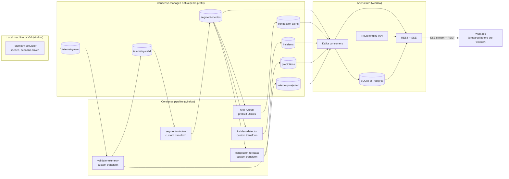

# Arterial architecture

Arterial is a real-time traffic intelligence system. It watches simulated vehicle telemetry for a
Bengaluru road network, classifies each road segment's congestion every 30 seconds, forecasts
which segments will slow down in the next 5, 10 and 15 minutes, flags abnormal traffic patterns,
and routes around congestion. Condense is the streaming backbone: ingestion, validation, windowed
aggregation, classification and topic routing run as a Condense pipeline.

> **Status, 24 Nov 2026.** Only `frontend/` and this documentation exist. Everything marked
> **(window)** is built during the Configure 2026 build window, Sat 28 Nov 00:00 IST to
> Sun 29 Nov 23:59 IST, as the rules require. Anything about Condense marked **confirm** must be
> checked against the organizers' starter kit before it is built.

## 1. Users and the problem

| User | What they need from Arterial |
|---|---|
| Traffic control operator | Which roads are jamming now, which will jam next, and why |
| Urban mobility analyst | Recurring peaks, unreliable corridors, congestion frequency |
| Fleet and logistics operator | A route that avoids the jam forming now, with the time it saves |
| Commuter | Leave now or wait, and by which road |

The core differentiator is the **forecast**. A segment at risk shows up before it turns red, with
the expected speed change and an honest error band.

## 2. System overview



| Component | Runs on | Language | Built |
|---|---|---|---|
| Telemetry simulator | Local or VM | Python 3.11 | window |
| Kafka topics | Condense-managed cluster | n/a | window |
| `validate-telemetry` | Condense custom transform | Python (**confirm** language support) | window |
| `segment-window` | Condense custom transform | Python | window |
| Alert routing | Condense Split and Alerts utilities | configuration | window |
| `incident-detector` | Condense custom transform | Python | window |
| `congestion-forecast` | Condense custom transform | Python + scikit-learn | window |
| Arterial API | Local, VM or container host | Python, FastAPI | window |
| Web app | Static host (Vercel, Netlify or the API itself) | TypeScript, React | **before the window, disclosed** |

## 3. The Condense pipeline

What the public docs (docs.condense.io, read 24 Nov 2026) say we can rely on:

- A pipeline runs input connector, then transforms and utilities, then output connector, with Kafka
  topics between stages.
- Prebuilt utilities include **Split** (rule-based routing of one topic to many, "first match" or
  "broadcast"), **Data Utility** (add, rename and remove fields), **Alerts** (fires when a
  condition holds for a duration, grouped by a key) and **Geofence**.
- Custom transforms are written in the Condense browser IDE or linked from a Git repository, built
  as container images from a Dockerfile, published with a version, and deployed into the pipeline
  with environment variables.
- No window or aggregation utility was found in the docs, so windowing is a custom transform.
  **Confirm** with the starter kit; if a window utility exists, use it and keep the custom
  transform for classification only.

| Stage | Kind | In | Out | What it does |
|---|---|---|---|---|
| `validate-telemetry` | custom transform | `telemetry-raw` | `telemetry-valid`, `telemetry-rejected` | Schema check, coordinate and speed bounds, missing GPS, unknown segment, duplicate `event_id` (TTL set, 10 min), late events tagged. Rejections carry a reason. |
| Stamp | Data Utility (prebuilt) | `telemetry-valid` | `telemetry-valid` (same or next topic) | Adds `pipeline_version` and keeps `source: "simulated"`. Used if it fits; optional. |
| `segment-window` | custom transform | `telemetry-valid` | `segment-metrics` | 30 s tumbling windows per segment on event time, 10 s allowed lateness. Computes the metrics in section 4 and classifies. Emits `level_changed` and `previous_level`. |
| Alert routing | Split utility (prebuilt) | `segment-metrics` | `congestion-alerts` | Routes windows where `level_changed == true` and `level` is heavy or severe. |
| Sustained alert | Alerts utility (prebuilt) | `segment-metrics` | `congestion-alerts` | Fires when `level == "severe"` holds for 2 minutes, grouped by `segment_id`. |
| `incident-detector` | custom transform | `segment-metrics` | `incidents` | Rules in section 6, with per-segment baselines. |
| `congestion-forecast` | custom transform | `segment-metrics` | `predictions` | Section 5. The model file ships inside the image. |

Topic names all start with the team prefix the organizers confirm, for example
`<prefix>.telemetry-raw`. Consumer groups do too: `<prefix>.api`. Full schemas are in
[EVENTS.md](EVENTS.md).

**Fallback if a custom transform cannot run on Condense in time:** the same Python module runs as a
local consumer against the same topics, and the README says so. The rules require the core
pipeline on Condense, so validation and windowing get priority.

## 4. Congestion detection

Every 30 s window, per segment, from validated reports:

| Quantity | Formula | Notes |
|---|---|---|
| Space-mean speed `v` | `n / sum(1 / max(v_i, 2))` | Harmonic mean of spot speeds; stopped vehicles count at 2 km/h so a queue is not divided by zero |
| Free-flow speed `v_ff` | 85th percentile of window speeds when density < 20% of jam density | Before history exists: `min(0.8 x speed limit, class default)` |
| Speed ratio `r` | `v / v_ff` | |
| Speed reduction | `100 x (1 - r)` | |
| Density `k` | `distinct vehicles / length_km / penetration` | `penetration` is the share of vehicles that report; 1.0 in simulation |
| Flow `q` | `k x v` | veh/h, the fundamental relation |
| Severity | `round(70 x clamp((1 - r) / 0.85) + 30 x clamp(k / k_jam))` | 0 to 100 |
| Trend | least-squares slope of `v` over the last 6 windows | worsening at <= -1.0 km/h per min, improving at >= +1.0 |

Levels, from the speed ratio, with a density override:

| Level | Rule |
|---|---|
| Free flow | `r >= 0.75` |
| Moderate | `0.50 <= r < 0.75` |
| Heavy | `0.30 <= r < 0.50`, or `k >= 0.6 x k_jam` |
| Severe | `r < 0.30` |
| No data | no reports in the window |

`k_jam` is 120 PCU per km per lane, a common figure for mixed Indian traffic, set per road class.
Escalation is immediate; de-escalation needs two windows in a row below the threshold, so a level
does not flicker. Fewer than 3 vehicles in a window keeps the previous level and says "low sample"
in the reason. Every threshold lives in one config file, `pipeline/config/congestion.yaml`
**(window)**, and the reason string quotes the numbers it used. The frontend colours segments
from `level`. It never classifies on its own.

## 5. Congestion forecast

Target: space-mean speed `v` at `t + h` for `h` = 5, 10 and 15 minutes, per segment.

1. **Persistence**, `v(t+h) = v(t)`. The yardstick every other model must beat.
2. **Rule baseline** (ships first): damped trend plus upstream pressure.
   `v(t+h) = v(t) + phi_h x slope x h - beta x max(0, upstream density rise)`, clipped to
   `[2, v_ff]`. Labelled `rule_baseline` in the API and the UI.
3. **Trained model**, once at least two simulated days of history exist: one gradient-boosted
   regressor per horizon (scikit-learn `HistGradientBoostingRegressor`). Features are the last 6
   speeds, slope, density, flow, ratio, upstream and downstream speed and density, time of day
   (sin and cos), road class and lanes.

Evaluation uses a time-blocked split (the last 20% of time is held out, never shuffled), reporting
MAE and RMSE per horizon beside persistence. The trained model ships only if it beats persistence
at every horizon on held-out data; otherwise the rule baseline stays and the UI says so.
Uncertainty is the 10th to 90th percentile of held-out residuals per horizon (split conformal).
The **risk score** is the share of that interval below the heavy threshold (`0.5 x v_ff`). It is a
score, not a calibrated probability, and the UI never shows it as a percentage chance.

## 6. Incident detection

Baselines per segment: exponentially weighted mean and variance of `v`, `k` and `q` per
15-minute time-of-day bucket, falling back to the segment's overall figures early on.

| Type | Fires when |
|---|---|
| Sudden speed drop | `v` falls 40% or more against the mean of the previous 4 windows, within 2 windows, and `z(v) <= -3` |
| Abnormal accumulation | `z(k) >= 3` and rising for 3 windows while `v` falls |
| Flow breakdown | `q` falls 35% or more while upstream density rises 25% or more |
| Possible blockage | `v < 5 km/h` for 2 windows with 3 or more vehicles, and downstream flow falls 50% or more |
| Unusual density | `z(k) >= 3.5` with no speed drop |

One active incident per segment and type; new windows update it, and 4 normal windows resolve it.
Each incident carries the evidence (baseline beside observed), the upstream segments whose density
rose, and a snapshot of conditions. These are **anomalies in simulated data, not verified
accidents**, and every incident payload says `"simulated": true`.

## 7. Route optimisation

- Directed graph from the road network: nodes are junctions, edges are segments.
- Edge cost under current conditions: `length / max(v, 3 km/h)`, using free-flow speed when a
  segment has no data, times 5 on a segment with an active possible-blockage incident.
- A* with a straight-line heuristic `haversine / v_max`, which never overestimates, so it returns
  the same path as Dijkstra, faster.
- **Free-flow fastest**: A* on free-flow costs, then timed at current conditions, so the response
  shows what the usual route costs today.
- **Alternative**: multiply the recommended path's edge costs by 1.5 and search again; keep the
  result if it shares under 60% of its length with the recommended path.
- The response explains the choice in plain language with the numbers, for example "Avoids 1.8 km
  of severe congestion on Outer Ring Road; 6 min faster than the usual route".

## 8. Persistence

SQLite for a one-machine judge run, Postgres through the same SQL for anything bigger. Raw
telemetry stays in Kafka; the database keeps a sample and every derived record.

| Table | Key | Contents |
|---|---|---|
| `road_nodes` | `id` | name, lng, lat |
| `road_segments` | `id` | name, class, nodes, length, limit, free-flow, lanes, geometry (JSON) |
| `telemetry_sample` | `event_id` | 1-in-20 sample of valid events, 24 h |
| `segment_metrics` | `(segment_id, window_end)` | every field of `SegmentState` |
| `alerts` | `alert_id` | kind, levels, times, message |
| `incidents` | `incident_id` | type, severity, status, times, reason, evidence, affected, conditions |
| `incident_events` | `(incident_id, ts)` | timeline |
| `predictions` | `(segment_id, made_at, horizon_min)` | forecast, interval, risk, model version, actual speed filled in later for scoring |
| `model_runs` | `version` | kind, trained_at, windows, evaluation (JSON) |
| `pipeline_health` | `(stage_id, ts)` | throughput, latency, errors per 10 s |

Writes are batched every second and idempotent: an upsert on each table's key, so a replayed Kafka
message cannot create a duplicate row.

## 9. Delivery to the app

- The API consumes the output topics in its own consumer group and keeps the latest state in
  memory for fast reads, writing to the database in batches.
- `GET /api/v1/stream` is Server-Sent Events. Each event has a monotonic id. A reconnecting client
  sends `Last-Event-ID` and receives what it missed from a 2-minute ring buffer, or a `snapshot`
  hint to refetch over REST.
- Backpressure: each client has a bounded queue. Vehicle frames are dropped oldest-first when a
  client falls behind; alerts, incidents and segment windows are never dropped.
- The frontend never polls for live data. It loads snapshots over REST once, then applies stream
  events.

## 10. Failure handling

| Failure | Behaviour |
|---|---|
| Broker unreachable | Producer and consumers retry with exponential backoff and jitter (0.5 s to 30 s); the system page shows Kafka down and the reconnect count |
| Invalid event | Sent to `telemetry-rejected` with a reason, counted on the system page, never silently dropped |
| Duplicate event | Dropped by `event_id` within 10 minutes, counted |
| Late or out-of-order event | Accepted into its window within 10 s of lateness, otherwise counted as late and kept out of closed windows |
| Empty segment | `level: "no_data"`, drawn grey, never guessed |
| API restart | Consumers resume from committed offsets; state rebuilds from the last 10 minutes of `segment-metrics` |
| Stream drop in the browser | The client reconnects with backoff, shows "Reconnecting", and resumes from the last event id |

## 11. Security

- Credentials only in environment variables; `.env` is git-ignored and `.env.example` lists names
  without values.
- Kafka over SASL_SSL with the team's own login; every topic and group uses the team prefix, as
  the organizers' ACL requires.
- The API validates every input with Pydantic, returns structured errors
  (`{"error": {"code", "message", "request_id"}}`), sets CORS to the app's origin, and
  rate-limits route requests.
- Scenario controls change only the simulator. Nothing in Arterial controls a real vehicle, a
  traffic signal or live infrastructure.
- No personal data: vehicle ids are synthetic (`SIM-V-0042`).

## 12. Repository layout

```
arterial/
  docs/            architecture, API and event contracts, build plan, compliance  (before window)
  frontend/        React web app                                                    (before window)
  simulator/       telemetry generator and road network builder                    (window)
  pipeline/        Condense custom transforms, one folder each, with Dockerfiles   (window)
    config/        congestion thresholds, topic names
  api/             FastAPI service: consumers, persistence, routes, REST, SSE      (window)
  models/          training and evaluation scripts, model files                    (window)
  tests/           integration and end-to-end tests                                (window)
```

## 13. Testing

| Layer | Tests | Built |
|---|---|---|
| Frontend | Unit tests for formatting, the stream client (reconnect, backoff, resume), store reducers; Playwright end-to-end against design fixtures and later against the live API | before window, then extended |
| Validation | Duplicates, missing GPS, invalid coordinates, out-of-order timestamps, unknown segments | window |
| Congestion | Known inputs to known metrics and levels, hysteresis, empty segments, sudden density changes | window |
| Forecast | Persistence and rule baseline on synthetic series; MAE and RMSE on held-out data | window |
| Routing | A* equals Dijkstra on random graphs; congestion changes the chosen path; unreachable pairs | window |
| API | Contract tests against `frontend/src/lib/contract.ts` shapes; error bodies | window |
| Kafka | Produce, then consume through the pipeline on the team's topics; consumer restart resumes from offsets | window |
| Failure drills | Stop the consumer, cut the network, restart the API, and watch the UI recover | window |
