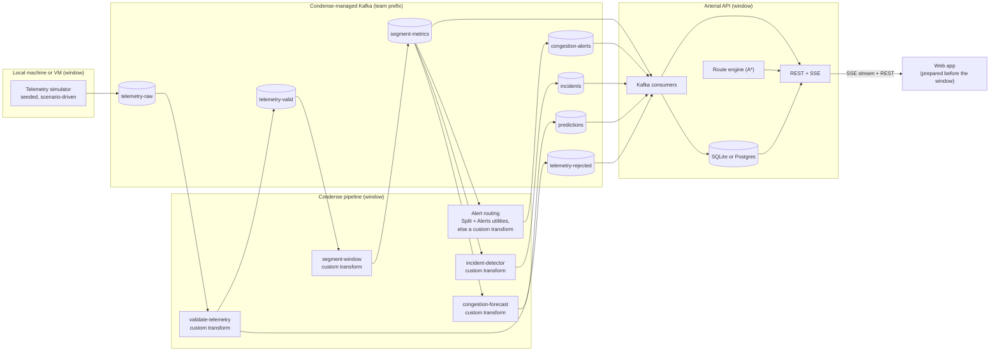

# Arterial architecture

Arterial is a real-time traffic intelligence system. It watches simulated vehicle telemetry on
India's roads, classifies each road segment's congestion every 30 seconds, forecasts
which segments will slow down in the next 5, 10 and 15 minutes, flags abnormal traffic patterns,
and routes around congestion. Condense is the streaming backbone: ingestion, validation, windowed
aggregation, classification and topic routing run as a Condense pipeline.

Coverage is configuration, not code (section 2.1): a national tier of India's expressways and
national highways, and city tiers in street-level detail, Bengaluru first.

> **Status, 25 Nov 2026.** Only `frontend/` and this documentation exist. Everything marked
> **(window)** is built during the Configure 2026 build window, Sat 28 Nov 00:00 IST to
> Sun 29 Nov 23:59 IST, as the rules require. Anything about Condense marked **confirm** must be
> checked against the organizers' starter kit before it is built. The team's Condense workspace
> was read (nothing created) on 27 Nov 2026; what it showed is in section 3.1.

## 1. Users and the problem

| User | What they need from Arterial |
|---|---|
| Traffic control operator | Which roads are jamming now, which will jam next, and why |
| Urban mobility analyst | Recurring peaks, unreliable corridors, congestion frequency |
| Fleet and logistics operator | A route, across the city or between cities, that avoids the jam forming now, with the time it saves |
| Highway control room | Which national highway stretches are slowing, anywhere in the country, and where an incident is building |
| Commuter | Leave now or wait, and by which road |

The core differentiator is the **forecast**. A segment at risk shows up before it turns red, with
the expected speed change and an honest error band.

## 2. System overview

> **As built, 28 Nov 2026.** The running system is drawn in the README (Architecture, as built): the
> simulator, four transforms on Condense (validate, segment window, forecast, alert router) and the API
> holding its state in memory. The diagram below is the original plan: Split and Alerts utilities
> (not in the sandbox Library), an incident detector (not built) and a database (not used).




| Component | Runs on | Language | Built |
|---|---|---|---|
| Telemetry simulator | Local or VM | Python 3.11 | window |
| Kafka topics | Condense-managed cluster | n/a | window |
| `validate-telemetry` | Condense custom transform | Python, in a Docker image built from our Git repository | window |
| `segment-window` | Condense custom transform | Python | window |
| Alert routing | Condense Split and Alerts utilities if the pipeline canvas offers them, else a custom transform | configuration or Python | window |
| `incident-detector` | Condense custom transform | Python | window |
| `congestion-forecast` | Condense custom transform | Python + scikit-learn | window |
| Arterial API | Local, VM or container host | Python, FastAPI | window |
| Web app | Static host (Vercel, Netlify or the API itself) | TypeScript, React | **before the window, disclosed** |

### 2.1 Regions: the whole country, and cities in detail **(window)**

Arterial covers India at two levels of detail. Nothing in the simulator, the pipeline, the API or
the web app names a place: each region is one config file, `config/regions/<id>.yaml`, and
`ARTERIAL_REGION` picks it for a process.

| Tier | Region | Roads | Built from | For |
|---|---|---|---|---|
| National | `in`, all of India | motorway and trunk: expressways and national highways; primary roads too if the usage limits allow | The Geofabrik India extract (`india-latest.osm.pbf`, 1.6 GB on 25 Nov 2026, ODbL), filtered with osmium | Fleet and logistics operators moving goods between cities; highway control rooms |
| City | `blr` Bengaluru first; any city is one more config file | motorway to secondary | osmnx, by the city's name or a bounding box | City traffic control rooms |

```yaml
# config/regions/blr.yaml
id: blr
kind: city
name: Bengaluru
osm_place: Bengaluru, Karnataka, India   # or bbox: [west, south, east, north]
road_classes: [motorway, trunk, primary, secondary]
max_segment_km: 3
probe_share: 1.0                          # share of all traffic the simulated vehicles stand for
fleet: { vehicles: 600, seed: 2026 }      # tuned in the window to the usage limits
scenarios:                                # where the demo scenarios happen, by road name
  build_up: { road: Outer Ring Road, near: Silk Board Junction }
  incident: { road: Outer Ring Road, near: Agara }
```

```yaml
# config/regions/in.yaml
id: in
kind: national
name: India
osm_extract: india-latest.osm.pbf         # download starts at 00:00 on 28 Nov
road_classes: [motorway, trunk]
max_segment_km: 10
probe_share: 0.05                         # each simulated vehicle stands for 20 real ones
fleet: { vehicles: 3000, seed: 2026 }     # tuned in the window to the usage limits
scenarios:
  incident: { road: chosen in the window, near: chosen in the window }
```

- **Network builder** (`simulator/network.py`). A city comes from osmnx; the national tier comes
  from the extract through `osmium tags-filter`. Both then go through the same steps: keep the
  configured road classes, merge junctions that are one intersection, split roads at junctions and
  cap a segment at `max_segment_km`. The national geometry is simplified (about 50 m tolerance) so a
  browser can draw the country. The builder writes `data/networks/<id>.json` in the `RoadNetwork`
  shape the API serves, with the OSM attribution, and prints the node count, segment count and file
  size.
- **Ids are unique across regions.** Segments are `<region>-<road code>-<nn>`, numbered along the
  road, with the code from the OSM `ref` tag (NH 44 becomes `in-NH44-0123`) or the initials of the
  road's name (Outer Ring Road becomes `blr-ORR-03`). Nodes are `<region>-N<nnnnn>`. Every region
  shares the same topics without a collision, and telemetry carries a `region` field so a Split
  utility can route by region.
- **Junction names** come from OSM: the junction's own name, else the roads that meet there
  ("27th Main Road and Outer Ring Road"). On the national tier, the nearest town is added
  ("NH 44 near Krishnagiri").
- **Probe share.** On the national tier the simulated vehicles are a sample of the traffic, as real
  probe data is. Density divides by the region's `probe_share` (the `penetration` in section 4).
- **Place search** (`GET /places`). In a city: junction names and the roads that meet there. On
  the national tier, also every city, town and village in the extract (`place=*` nodes, ODbL), each
  snapped to the nearest highway junction, with the distance to it. No outside geocoding service.
- **Routing stays inside one region** (section 7). A national route runs highway to highway, from
  the junctions nearest the two places; the streets at either end are not modelled outside the
  detailed cities, and the app says so. Joining a city's streets to the national highways in one
  route is a next step.
- **Event volume.** The national tier is far larger than any city. The probe share and vehicle
  count are tuned so the total stays inside the organizers' usage limits (**confirm**: the
  workspace shows no limits, only vCPU hours used and a trial with 7 days left on 27 Nov 2026). For the
  national region, the stream sends only segments whose level changed in a window (the web app
  already merges partial updates by id); the REST snapshot holds every segment.
- **Running regions.** One simulator and one API process per region, all on the same topics.
  Bengaluru runs first; the national tier joins once the city works end to end (BUILD-PLAN.md).
- **What changes per region:** the network file, the probe share, the scenario locations and the
  fleet size. **What stays the same:** every transform, topic, threshold, endpoint and screen.
- **Forecast models are per region.** A region without its own evaluated model runs the rule
  baseline from its first window, and the API and the web app say so (section 5). The trained
  Bengaluru model is never presented as valid elsewhere without that region's held-out evaluation.
- **Incident baselines** start empty in a new region and fall back to the segment's overall figures
  (section 6), as they do on any cold start.
- **Data stays synthetic.** Road geometry is OpenStreetMap (ODbL) for every region; traffic is
  always simulated. Live traffic from commercial providers is out: the Google, TomTom, HERE and
  Mapbox terms read on 25 Nov 2026 all forbid storing their results, which a Kafka topic does.

## 3. The Condense pipeline

What the public docs (docs.condense.io, read 24 Nov 2026) say we can rely on:

- A pipeline runs input connector, then transforms and utilities, then output connector, with Kafka
  topics between stages.
- Prebuilt utilities include **Split** (rule-based routing of one topic to many, "first match" or
  "broadcast"), **Data Utility** (add, rename and remove fields), **Alerts** (fires when a
  condition holds for a duration, grouped by a key) and **Geofence**.
- Custom transforms are written in the Condense browser IDE or linked from a Git repository, built
  as container images from a Dockerfile, published with a version, and deployed into the pipeline
  with environment variables.
- No window or aggregation utility was found in the docs, nor in the workspace's Library on
  27 Nov 2026 (section 3.1), so windowing is a custom transform.

| Stage | Kind | In | Out | What it does |
|---|---|---|---|---|
| `validate-telemetry` | custom transform | `telemetry-raw` | `telemetry-valid`, `telemetry-rejected` | Schema check, coordinate and speed bounds, missing GPS, unknown segment, duplicate `event_id` (TTL set, 10 min), late events tagged. Rejections carry a reason. |
| Stamp | Data Utility (prebuilt) | `telemetry-valid` | `telemetry-valid` (same or next topic) | Adds `pipeline_version` and keeps `source: "simulated"`. Used if it fits; optional. |
| `segment-window` | custom transform | `telemetry-valid` | `segment-metrics` | 30 s tumbling windows per segment on event time, 10 s allowed lateness. Computes the metrics in section 4 and classifies. Emits `level_changed` and `previous_level`. |
| Alert routing | Split utility (prebuilt), else `alert-router` (custom) | `segment-metrics` | `congestion-alerts` | Routes windows where `level_changed == true` and `level` is heavy or severe. |
| Sustained alert | Alerts utility (prebuilt), else `alert-router` (custom) | `segment-metrics` | `congestion-alerts` | Fires when `level == "severe"` holds for 2 minutes, grouped by `segment_id`. |
| `incident-detector` | custom transform | `segment-metrics` | `incidents` | Rules in section 6, with per-segment baselines. |
| `congestion-forecast` | custom transform | `segment-metrics` | `predictions` | Section 5. The model file ships inside the image. |

Topic names all start with the team prefix the organizers confirm, for example
`<prefix>.telemetry-raw`. Consumer groups do too: `<prefix>.api`. Full schemas are in
[EVENTS.md](EVENTS.md).

### 3.0 What runs on Condense now (28 Nov 2026, build window)

| Piece | Where | Status |
|---|---|---|
| Kafka topics `codeverse_telemetry-raw`, `-valid`, `-rejected`, `codeverse_segment-metrics`, `codeverse_congestion-alerts`, `codeverse_incidents`, `codeverse_predictions` | The team's Condense Kafka (2 brokers, SASL SCRAM-SHA-512; the team's ACLs allow only names starting `codeverse_`) | Created by `python -m pipeline.topics` |
| Condense application `arterial` | Built by Condense from this repository's `Dockerfile` (branch `main`), published as a Transform; its variables are `ARTERIAL_STAGE`, `TEAM_PREFIX` and the `KAFKA_*` settings, the password as a Password variable | Published 1.0.0 |
| Transform `arterial-validate-telemetry` (`ARTERIAL_STAGE=validate`) | Condense pipeline, Codeverse workspace | Running: telemetry-raw to telemetry-valid and telemetry-rejected |
| Transform `arterial-segment-window` (`ARTERIAL_STAGE=window`) | Condense pipeline, Codeverse workspace | Running: telemetry-valid to segment-metrics |
| Simulator (`python -m simulator.sim --region in` and `--region blr`) | A laptop, producing to `codeverse_telemetry-raw` | Running |

Checked with `python -m pipeline.peek` once both stages ran only on Condense: in 75 s, 23,175 raw events,
27,471 valid (the validator was catching up), 433 rejected by reason and 2,779 segment windows for the
`in` and `blr` regions.

### 3.1 What the workspace showed (read on 27 Nov 2026, nothing created)

The team's login opens Condense Core v3.0.0. Read only: no connector, application, topic or
broker connection was created before the window.

| Question | Answer | Still to confirm |
|---|---|---|
| Where we build | Workspace **Codeverse**, created by the organizers for Configure 2026: our account as Maintainer and two Condense staff as Environment Admins, in the shared **Sandbox** environment (Azure, `southasia`). Every Configure 2026 team works in that one environment (over 100 members on 27 Nov), so every topic, consumer group and application name must carry the team prefix to avoid collisions | The prefix itself: the workspace does not show one. Ask the organizers whether it is `codeverse` |
| How a pipeline is made | It is not created by hand: it appears on the canvas as connectors and transforms are deployed, joined wherever one block's output topic matches the next one's input topic | |
| Who can deploy | Workspace Admins and Maintainers deploy and configure connectors and transforms; Developers can build applications but not deploy them. Our account is a Maintainer, so it can build, publish and deploy | |
| Custom transform language | Any: an application is created from a GitHub, GitLab or Bitbucket repository and branch, built in Condense into a Docker image (name and tag) from our Dockerfile, published as a Custom Transform, then deployed from the canvas (**+ Add Transform**, Custom) with its input and output topics and environment variables. Python is fine | |
| Application names | Lowercase, 3 to 63 characters, unique in the workspace. The docs disagree on whether digits, `-` and `_` are allowed, so the applications use plain lowercase letters: `arterialvalidate`, `arterialwindow`, `arterialincident`, `arterialforecast`, `arterialalerts` | The prefix rule may change these |
| Testing a transform | The browser IDE has Publish and Subscribe testers that send to and read from a topic through a saved broker connection | |
| Library (prebuilt connectors) | Five in this sandbox: Scania (input), Apache Kafka to NATS (input), NATS to Apache Kafka (output), NATS to MongoDB (output) and Data Simulator (input). No Split, Alerts, Data Utility, Geofence or window utility is listed; the older v2.6 docs list Split, Merge and Data utilities | Whether **+ Add Transform** on the canvas offers Split or Alerts; if not, `alert-router` does their job as a custom transform |
| How data moves | Through a broker saved under Settings, Broker Connections: managed (Embedded NATS JetStream, Condense Kafka Broker, Confluent Cloud) or self-managed (NATS, Apache Kafka). A Kafka connection is bootstrap servers, a security protocol (SASL_SSL with PLAIN or SCRAM, among others) and a login. Our account had none on 27 Nov | The Condense Kafka Broker's bootstrap address and login: not shown anywhere in the workspace, so they come from the organizers. The simulator and the API then connect as ordinary Kafka clients, with the values in `.env` |
| Condense's Data Simulator | Generates telematics events (GPS, speed, diagnostics) every 1 s or slower into a Kafka topic, and asks for the Kafka bootstrap URL, username and password. It knows nothing of roads, so it cannot replace our simulator, which drives vehicles along OpenStreetMap segments. Useful only as a first check that a broker and a transform work | |
| AI help inside Condense | Vapr (an assistant with a Coding Agent that can write transforms) and a Condense MCP server for outside AI tools | If either is used, COMPLIANCE.md says so |

**Fallback if a custom transform cannot run on Condense in time:** the same Python module runs as a
local consumer against the same topics, and the README says so. The rules require the core
pipeline on Condense, so validation and windowing get priority.

## 4. Congestion detection

Every 30 s window, per segment, from validated reports:

| Quantity | Formula | Notes |
|---|---|---|
| Space-mean speed `v` | `n / sum(1 / max(v_i, 2))` | Harmonic mean of spot speeds; stopped vehicles count at 2 km/h so a queue is not divided by zero |
| Free-flow speed `v_ff` | 85th percentile of window speeds when density < 20% of jam density | Before history exists: `min(0.8 x speed limit, class default)` |
| Speed ratio `r` | `v / v_ff` | |
| Speed reduction | `100 x (1 - r)` | |
| Density `k` | `distinct vehicles / length_km / penetration` | `penetration` is the share of vehicles that report: the region's `probe_share`, 1.0 in a city and 0.05 on the national tier |
| Flow `q` | `k x v` | veh/h, the fundamental relation |
| Severity | `round(70 x clamp((1 - r) / 0.85) + 30 x clamp(k / k_jam))` | 0 to 100 |
| Trend | least-squares slope of `v` over the last 6 windows | worsening at <= -1.0 km/h per min, improving at >= +1.0 |

Levels, from the speed ratio, with a density override:

| Level | Rule |
|---|---|
| Free flow | `r >= 0.75` |
| Moderate | `0.50 <= r < 0.75` |
| Heavy | `0.30 <= r < 0.50`, or `k >= 0.6 x k_jam` |
| Severe | `r < 0.30` |
| No data | no reports in the window |

`k_jam` is 120 PCU per km per lane, a common figure for mixed Indian traffic, set per road class.
Escalation is immediate; de-escalation needs two windows in a row below the threshold, so a level
does not flicker. Fewer than 3 vehicles in a window keeps the previous level and says "low sample"
in the reason. Every threshold lives in one config file, `pipeline/config/congestion.yaml`
**(window)**, and the reason string quotes the numbers it used. The frontend colours segments
from `level`. It never classifies on its own.

## 5. Congestion forecast

Target: space-mean speed `v` at `t + h` for `h` = 5, 10 and 15 minutes, per segment.

1. **Persistence**, `v(t+h) = v(t)`. The yardstick every other model must beat.
2. **Rule baseline** (ships first): damped trend plus upstream pressure.
   `v(t+h) = v(t) + phi_h x slope x h - beta x max(0, upstream density rise)`, clipped to
   `[2, v_ff]`. Labelled `rule_baseline` in the API and the UI.
3. **Trained model**, once at least two simulated days of history exist: one gradient-boosted
   regressor per horizon (scikit-learn `HistGradientBoostingRegressor`). Features are the last 6
   speeds, slope, density, flow, ratio, upstream and downstream speed and density, time of day
   (sin and cos), road class and lanes.

Evaluation uses a time-blocked split (the last 20% of time is held out, never shuffled), reporting
MAE and RMSE per horizon beside persistence. The trained model ships only if it beats persistence
at every horizon on held-out data; otherwise the rule baseline stays and the UI says so.
Uncertainty is the 10th to 90th percentile of held-out residuals per horizon (split conformal).
The **risk score** is the share of that interval below the heavy threshold (`0.5 x v_ff`). It is a
score, not a calibrated probability, and the UI never shows it as a percentage chance.

Models, evaluations and residual intervals are kept per region (`models/<region>/`). `ModelInfo`
reports which region a model was evaluated on.

## 6. Incident detection

Baselines per segment: exponentially weighted mean and variance of `v`, `k` and `q` per
15-minute time-of-day bucket, falling back to the segment's overall figures early on.

| Type | Fires when |
|---|---|
| Sudden speed drop | `v` falls 40% or more against the mean of the previous 4 windows, within 2 windows, and `z(v) <= -3` |
| Abnormal accumulation | `z(k) >= 3` and rising for 3 windows while `v` falls |
| Flow breakdown | `q` falls 35% or more while upstream density rises 25% or more |
| Possible blockage | `v < 5 km/h` for 2 windows with 3 or more vehicles, and downstream flow falls 50% or more |
| Unusual density | `z(k) >= 3.5` with no speed drop |

One active incident per segment and type; new windows update it, and 4 normal windows resolve it.
Each incident carries the evidence (baseline beside observed), the upstream segments whose density
rose, and a snapshot of conditions. These are **anomalies in simulated data, not verified
accidents**, and every incident payload says `"simulated": true`.

## 7. Route optimisation

- Directed graph from the region's whole road network: nodes are junctions, edges are segments,
  so any two junctions in the region can be routed: two streets in Bengaluru, or two towns at
  opposite ends of the country on the national tier. Two-way roads get an edge in each direction.
- **Place search**: `GET /places?q=` (section 2.1). Every result is a junction, ready for a route
  request; on the national tier a result can be a town or village snapped to its nearest highway
  junction, with the distance shown. A place the region doesn't cover returns no match, and the web
  app says what the region covers.
- Edge cost under current conditions: `length / max(v, 3 km/h)`, using free-flow speed when a
  segment has no data, times 5 on a segment with an active possible-blockage incident.
- A* with a straight-line heuristic `haversine / v_max`, which never overestimates, so it returns
  the same path as Dijkstra, faster.
- **Free-flow fastest**: A* on free-flow costs, then timed at current conditions, so the response
  shows what the usual route costs today.
- **Alternative**: multiply the recommended path's edge costs by 1.5 and search again; keep the
  result if it shares under 60% of its length with the recommended path.
- The response explains the choice in plain language with the numbers, for example "Avoids 1.8 km
  of severe congestion on Outer Ring Road; 6 min faster than the usual route".

## 8. Persistence

SQLite for a one-machine judge run, Postgres through the same SQL for anything bigger. Raw
telemetry stays in Kafka; the database keeps a sample and every derived record.

| Table | Key | Contents |
|---|---|---|
| `road_nodes` | `id` | region, name, lng, lat |
| `road_segments` | `id` | region, name, class, nodes, length, limit, free-flow, lanes, geometry (JSON) |
| `places` | `(region, name, lng, lat)` | kind, nearest junction, distance to it; the national gazetteer |
| `telemetry_sample` | `event_id` | 1-in-20 sample of valid events, 24 h |
| `segment_metrics` | `(segment_id, window_end)` | every field of `SegmentState` |
| `alerts` | `alert_id` | kind, levels, times, message |
| `incidents` | `incident_id` | type, severity, status, times, reason, evidence, affected, conditions |
| `incident_events` | `(incident_id, ts)` | timeline |
| `predictions` | `(segment_id, made_at, horizon_min)` | forecast, interval, risk, model version, actual speed filled in later for scoring |
| `model_runs` | `version` | kind, trained_at, windows, evaluation (JSON) |
| `pipeline_health` | `(stage_id, ts)` | throughput, latency, errors per 10 s |

Writes are batched every second and idempotent: an upsert on each table's key, so a replayed Kafka
message cannot create a duplicate row.

## 9. Delivery to the app

- The API consumes the output topics in its own consumer group and keeps the latest state in
  memory for fast reads, writing to the database in batches.
- `GET /api/v1/stream` is Server-Sent Events. Each event has a monotonic id. A reconnecting client
  sends `Last-Event-ID` and receives what it missed from a 2-minute ring buffer, or a `snapshot`
  hint to refetch over REST.
- Backpressure: each client has a bounded queue. Vehicle frames are dropped oldest-first when a
  client falls behind; alerts, incidents and segment windows are never dropped.
- The frontend never polls for live data. It loads snapshots over REST once, then applies stream
  events.

## 10. Failure handling

| Failure | Behaviour |
|---|---|
| Broker unreachable | Producer and consumers retry with exponential backoff and jitter (0.5 s to 30 s); the system page shows Kafka down and the reconnect count |
| Invalid event | Sent to `telemetry-rejected` with a reason, counted on the system page, never silently dropped |
| Duplicate event | Dropped by `event_id` within 10 minutes, counted |
| Late or out-of-order event | Accepted into its window within 10 s of lateness, otherwise counted as late and kept out of closed windows |
| Empty segment | `level: "no_data"`, drawn grey, never guessed |
| API restart | Consumers resume from committed offsets; state rebuilds from the last 10 minutes of `segment-metrics` |
| Stream drop in the browser | The client reconnects with backoff, shows "Reconnecting", and resumes from the last event id |

## 11. Security

- Credentials only in environment variables; `.env` is git-ignored and `.env.example` lists names
  without values.
- Kafka over the security protocol the organizers' broker uses (SASL_SSL expected) with the team's
  own login; every topic and group uses the team prefix, as the organizers' ACL requires.
- The API validates every input with Pydantic, returns structured errors
  (`{"error": {"code", "message", "request_id"}}`), sets CORS to the app's origin, and
  rate-limits route requests.
- Scenario controls change only the simulator. Nothing in Arterial controls a real vehicle, a
  traffic signal or live infrastructure.
- No personal data: vehicle ids are synthetic (`SIM-V-0042`).

## 12. Repository layout

```
arterial/
  docs/            architecture, API and event contracts, build plan, compliance  (before window)
  frontend/        React web app                                                    (before window)
  config/regions/  one YAML file per region: the national tier and each city         (window)
  data/networks/   road networks the builder generates, one JSON per region (ODbL)  (window)
  simulator/       telemetry generator and road network builder                    (window)
  pipeline/        Condense custom transforms, one folder each, with Dockerfiles   (window)
    config/        congestion thresholds, topic names
  api/             FastAPI service: consumers, persistence, routes, REST, SSE      (window)
  models/          training and evaluation scripts, model files                    (window)
  tests/           integration and end-to-end tests                                (window)
```

## 13. Testing

| Layer | Tests | Built |
|---|---|---|
| Frontend | Unit tests for formatting, the stream client (reconnect, backoff, resume), store reducers; Playwright end-to-end against design fixtures and later against the live API | before window, then extended |
| Validation | Duplicates, missing GPS, invalid coordinates, out-of-order timestamps, unknown segments | window |
| Congestion | Known inputs to known metrics and levels, hysteresis, empty segments, sudden density changes | window |
| Forecast | Persistence and rule baseline on synthetic series; MAE and RMSE on held-out data | window |
| Network builder | Bengaluru and the national tier build; ids are stable across rebuilds and never collide; every segment's ends are nodes in the same file; the national file stays small enough for the browser | window |
| Routing | A* equals Dijkstra on random graphs; congestion changes the chosen path; unreachable pairs; place search finds junctions and roads | window |
| API | Contract tests against `frontend/src/lib/contract.ts` shapes; error bodies | window |
| Kafka | Produce, then consume through the pipeline on the team's topics; consumer restart resumes from offsets | window |
| Failure drills | Stop the consumer, cut the network, restart the API, and watch the UI recover | window |
